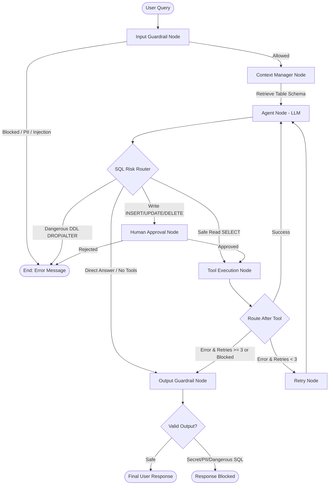

# DBOps Agent: Repository Analysis & Future Work Roadmap

> **Document Version:** 1.0.0  
> **Repository:** `dbops-agent`  
> **Last Updated:** October 2026  
> **Author:** Antigravity AI Assistant

---

## 1. Executive Summary

**DBOps Agent** is an autonomous database operations and analytics assistant built with **LangGraph**, **LangChain**, and **PostgreSQL**. Its primary objective is to allow natural language querying and modification of relational databases while enforcing strict safety guardrails and Human-in-the-Loop (HITL) authorization for write operations.

### Key Architectural Highlights
- **Stateful Graph Orchestration**: Managed via LangGraph with checkpointing persistence backed by PostgreSQL (`PostgresSaver`).
- **Multi-Layered Security Guardrails**: Input validation (prompt injection detection, PII filtering via Presidio), AST-based SQL classification and validation via `sqlglot`, and output scanning (secret leaks, database credentials, dangerous DDL patterns).
- **Human-In-The-Loop (HITL)**: Interrupt-driven gating for sensitive write operations (INSERT, UPDATE, DELETE).
- **Autonomous Error Recovery**: Self-correcting retry loop when PostgreSQL query execution encounters errors.

---

## 2. Current Architecture & System Workflow



---

## 3. Detailed Component Analysis

### 3.1 LangGraph State & Execution Flow
- **State Definition (`app/state.py`)**: Defined with `AgentState` containing `messages`, `schema_context`, `sql_query`, `sql_result`, `error`, `retry_count`, and `approval_status`.
- **Checkpointer (`app/graph.py`)**: Uses `PostgresSaver` connecting via `psycopg` to persist execution checkpoints per thread ID.

### 3.2 Security & Guardrail Subsystem
- **Input Guard (`app/security/input_guard.py`)**:
  - Regex-based prompt injection detection (e.g. `ignore previous instructions`, `reveal your prompt`).
  - Maximum character length cap (1,000 characters).
  - PII detection using Microsoft Presidio Analyzer (`CREDIT_CARD`, `US_SSN`, `PHONE_NUMBER`).
- **SQL Guard & Policy (`app/security/sql_guard.py`, `app/security/sql_policy.py`)**:
  - AST parsing with `sqlglot` targeting PostgreSQL dialect.
  - Rejects multi-statement execution to prevent stacked SQL injections.
  - Classifies AST into `read` (`exp.Select`), `write` (`exp.Insert`, `exp.Update`, `exp.Delete`), or `blocked` (all other expressions including DDL/DCL).
- **Output Guard (`app/security/output_guard.py`)**:
  - Scans outbound messages for secrets (`api_key`, `password`, `access_token`, `bearer`), database connection URIs, raw dangerous SQL commands, and PII.
  - Length enforcement (maximum 5,000 characters).

### 3.3 Database Interaction & Tools
- **Read Tool (`app/tools/database.py`)**: Executes read queries, fetches up to `MAX_ROWS = 100`, formats result as dictionaries.
- **Write Tool (`app/tools/database_write.py`)**: Defines `execute_write_sql` with transaction commit/rollback logic.
- **Schema Tool (`app/tools/schema.py`)**: Dynamically queries PostgreSQL `information_schema` for tables, columns, data types, primary keys, and foreign keys.

### 3.4 Context Management
- **Schema Context (`app/context/schema_context.py`)**:
  - Stores a hardcoded metadata dictionary of 4 tables (`customers`, `products`, `orders`, `payments`).
  - Uses basic keyword matching over table names, column names, and descriptions to score and rank relevant tables (top 3).

### 3.5 Observability & Testing
- **Observability (`app/observability/`)**:
  - Centralized logger with structured format (`event=... | node=...`).
  - Integrated LangSmith tracing support via environment variables.
- **Evaluation Suite (`app/eval/`)**:
  - Test suites covering business query accuracy (5 cases), SQL safety (5 cases), input guardrails (12 cases), and output guardrails (15 cases).

---

## 4. Critical Issues & Architectural Bottlenecks Discovered

### ⚠️ Issue 1: Write Operations Cannot Execute Even When Approved (High Severity)
- **Problem**: When a user submits an `INSERT`, `UPDATE`, or `DELETE` query, the router properly sends it to `approval`. When approved, it routes to `ToolNode(tools)`. The tool called by the LLM is `execute_sql`.
- In `app/tools/database.py`, line 28 calls `validate_sql(query)`.
- In `app/security/sql_guard.py`, line 43 explicitly enforces:
  ```python
  if not isinstance(statement, exp.Select):
      return False, "Only SELECT queries are allowed."
  ```
- **Consequence**: Every approved write operation gets blocked with `SQL_BLOCKED: Only SELECT queries are allowed`. The write never reaches the database!
- Furthermore, `execute_write_sql` in `app/tools/database_write.py` exists as an unused orphan tool: it is not exported in `app/tools/__init__.py` and not bound to the model.

### ⚠️ Issue 2: Import-Time Database Connection & Startup Hang (Medium Severity)
- **Problem**: In `app/graph.py`, line 226:
  ```python
  conn = Connection.connect(os.getenv("DB_URI"), ...)
  checkpointer = PostgresSaver(conn)
  checkpointer.setup()
  ```
- **Consequence**: Connecting to PostgreSQL happens at python module import time. Any script importing `graph` (including offline evaluations, unit tests, or CLI commands) hangs or crashes if PostgreSQL is not already running or network is unreachable.
- **Solution**: Checkpointer connection initialization should be lazy-loaded, wrapped in a factory/lifespan function, or configurable with an in-memory checkpointer (`MemorySaver`) for testing and offline evaluation.

### ⚠️ Issue 3: Inconsistent Docker Compose Configuration (Low Severity)
- **Problem**: In `docker-compose.yml`:
  ```yaml
  environment:
    POSTGRES_DB: chat_agent_db
  healthcheck:
    test: [ "CMD", "pg_isready", "-U", "postgres", "-d", "dbops_demo" ]
  ```
  The database created is `chat_agent_db`, but the healthcheck tests connection against `dbops_demo`. This causes healthchecks to report failure or mismatch.
  In `.env`, the database name is `dbops_demo`.

### ⚠️ Issue 4: Credentials Committed to Version Control Risk (Security Severity)
- **Problem**: The project root has a `.env` file containing plaintext API keys and database credentials. The `.gitignore` file currently does **not** include `.env`.
- **Consequence**: Any `git add .` or `git commit -a` will leak credentials to source control.
- **Action Needed**: Add `.env` to `.gitignore` and provide `.env.example`.

### ⚠️ Issue 5: Dependency Management Inconsistency
- **Problem**:
  - `requirements.txt` has `langgraph`, `langchain`, `langchain-openai`, `python-dotenv`, `psycopg2-binary`, `sqlglot`.
  - `pyproject.toml` lists `requires-python = ">=3.14"` and only `grandalf` and `langgraph-checkpoint-postgres`.
  - `presidio-analyzer` is imported in `app/security/pii_guard.py` but missing from both `requirements.txt` and `pyproject.toml`.
  - Dual PostgreSQL drivers: `psycopg2` (v2) is used in `app/db/connection.py`, while `psycopg` (v3) is used in `app/graph.py`.

### ⚠️ Issue 6: Static, Hardcoded Schema Knowledge
- **Problem**: `app/context/schema_context.py` defines schemas manually in a Python dictionary.
- **Consequence**: If the database schema changes, new tables are migrated, or new columns added, the context manager has no awareness. Additionally, keyword matching fails on semantic synonyms (e.g. "top spending customer" misses `orders.total_amount`).

---

## 5. Roadmap for Future Work

```
+---------------------------------------------------------------------------------+
|                               FUTURE WORK ROADMAP                               |
+---------------------+---------------------+-------------------------------------+
| Phase 1: Near-Term  | Phase 2: Core AI    | Phase 3: Platform & Production     |
| (Bug Fixes & Safety)| (Context & Reasoning| (Scalability, Observability & UI)   |
+---------------------+---------------------+-------------------------------------+
| • Fix write-tool bug| • Dynamic DB schema | • FastAPI / REST API service        |
| • Lazy checkpointer | • Vector schema link| • Web UI (Chat & Schema Explorer)   |
| • .env in .gitignore| • SQL dialect tests | • OpenTelemetry & Metric dashboards |
| • Sync dependencies | • Few-shot RAG store| • Read-replica & Connection pooling |
| • Unify PG drivers  | • Rollback safety   | • RBAC & Multi-tenant DB support    |
+---------------------+---------------------+-------------------------------------+
```

### Phase 1: High-Priority Fixes & Hardening (Immediate)

1. **Resolve Tool Execution Contradiction for Write Operations**:
   - Update `app/tools/database.py` or separate tool permissions so `execute_sql` respects router-approved write operations.
   - Alternatively, supply `execute_write_sql` specifically during the approval branch, or pass approval context into `validate_sql(query, allow_write=is_approved)`.
2. **Implement Lazy Initialization / Configurable Checkpointer**:
   - Provide an optional `MemorySaver` when running in test/evaluation environments without requiring a live Postgres instance.
   - Encapsulate `PostgresSaver` setup inside a startup function or context manager instead of top-level module code.
3. **Harmonize Database Drivers**:
   - Migrate entirely to `psycopg` (v3) across `connection.py`, `migration.py`, and `graph.py` to eliminate `psycopg2-binary` redundancy and gain native async support.
4. **Environment & Security Hygiene**:
   - Add `.env` and `.env.*` to `.gitignore`.
   - Create a sanitized `.env.example` file.
   - Fix `docker-compose.yml` database name consistency (`dbops_demo`).
   - Pin all dependencies (including `presidio-analyzer` and Spacy models) in `pyproject.toml` / `requirements.txt`.

---

### Phase 2: Schema Context & SQL Intelligence (Medium-Term)

1. **Dynamic Schema Introspection & Cache**:
   - Replace hardcoded `SCHEMA_METADATA` with automated introspection using PostgreSQL system catalogs.
   - Cache schema metadata with a configurable TTL (e.g., 1 hour) or trigger invalidation on DDL changes.
2. **Embedding-Based Schema Linking (Dense Retrieval)**:
   - Use vector embeddings (e.g. with `SentenceTransformers` or OpenAI embeddings) to index table schemas, column descriptions, and business comments.
   - Match user queries to relevant tables using hybrid retrieval (BM25 keyword search + Dense Semantic Vector similarity) instead of naive keyword counts.
3. **Few-Shot SQL Generation & Golden Query Bank**:
   - Introduce a repository of domain-specific "golden" SQL queries.
   - Dynamically inject the top-2 most relevant query-SQL pairs into the system prompt for improved accuracy on complex joins and window functions.
4. **Transaction Rollback & Dry-Run Simulations**:
   - Add `EXPLAIN` and transaction dry-runs (`BEGIN ... ROLLBACK`) for write queries prior to human approval to provide the human reviewer with estimated affected row counts and query plans.

---

### Phase 3: Advanced Security & Guardrail Modernization

1. **LLM-Based Guardrail or NeMo Guardrails Integration**:
   - Complement basic regex checks with a fast, lightweight classification model (e.g., Llama-Guard or dedicated safety classifier) to detect sophisticated indirect prompt injections and jailbreaks.
2. **Fine-Grained Role-Based Access Control (RBAC)**:
   - Associate users and sessions with database roles (`read_only_analyst`, `ops_admin`, etc.).
   - Dynamically execute queries through database users constrained by PostgreSQL permissions and Row-Level Security (RLS).
3. **PII Masking / Anonymization in Query Results**:
   - Instead of blocking the whole response when PII is returned, integrate Presidio Anonymizer to mask customer emails, phone numbers, or card numbers (`john@*****.com`, `***-***-0199`) in the final output.

---

### Phase 4: Production Infrastructure & Operations

1. **Async & Streaming Support**:
   - Convert graph invocations and tool executions to `async` (`ainvoke`, `astream`) to support streaming tokens and concurrent user sessions.
2. **REST API & Webhook Service**:
   - Build a **FastAPI** server exposing endpoints:
     - `POST /api/chat`: Query execution with streaming response.
     - `POST /api/chat/resume`: Endpoint to submit human approval decisions (`approve` / `reject`).
     - `GET /api/schema`: Interactive database schema viewer.
3. **Production Connection Pooling**:
   - Replace one-off connection instantiation with `psycopg_pool.ConnectionPool` or `SQLAlchemy` connection pool to eliminate connection exhaustion under load.
4. **Enhanced Observability & Metrics**:
   - Track LLM token consumption, inference latency, SQL execution time, retry rate, and approval rejection statistics.
   - Export OpenTelemetry metrics to Prometheus / Grafana.

---

### Phase 5: Testing, Benchmarking & CI/CD

1. **Comprehensive Pytest Suite**:
   - Unit tests for AST parsing (`sql_guard.py`), PII detection (`pii_guard.py`), and router conditions (`sql_router.py`).
   - Mock database execution tests using `unittest.mock` or SQLite in-memory dialect.
2. **Standardized Spider / BIRD Benchmark Integration**:
   - Add automated accuracy benchmarks using standard Text-to-SQL evaluation benchmarks to track semantic accuracy over time.
3. **GitHub Actions CI/CD Pipeline**:
   - Automated linting (`ruff`, `black`), type checking (`mypy`), and security scans on pull requests.

---

## 6. Implementation Action Plan Summary

| Priority | Task Description | Target Module | Est. Effort |
|:---|:---|:---|:---|
| 🔴 P0 | Fix write SQL validation bug & wire `database_write.py` | `app/tools/`, `app/security/` | 1 day |
| 🔴 P0 | Make checkpointer connection lazy / support in-memory fallback | `app/graph.py` | 0.5 day |
| 🔴 P0 | Secure `.env` in `.gitignore` and create `.env.example` | Root | 0.5 hour |
| 🟡 P1 | Fix `docker-compose.yml` healthcheck & DB name mismatch | `docker-compose.yml` | 0.5 hour |
| 🟡 P1 | Harmonize dependencies & pin Presidio + Spacy | `pyproject.toml`, `requirements.txt` | 1 hour |
| 🟡 P1 | Dynamic schema discovery & hybrid retrieval | `app/context/` | 2 days |
| 🟢 P2 | Dry-run / `EXPLAIN` preview for human approvals | `app/nodes/human_approval.py` | 1 day |
| 🟢 P2 | FastAPI service layer with WebSocket/SSE streaming | `app/api/` | 3 days |
| 🟢 P3 | PII Anonymization & output masking | `app/security/output_guard.py` | 1.5 days |

---

*This document serves as the master technical assessment and forward-looking roadmap for the DBOps Agent repository.*
